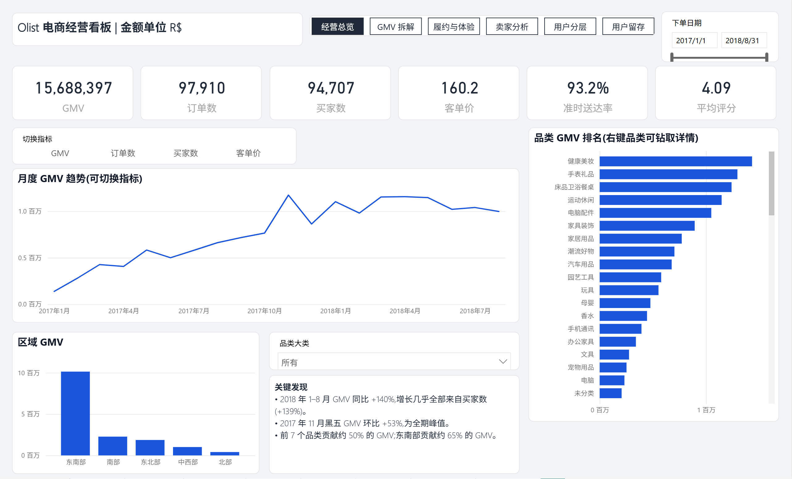

# Olist 巴西电商经营分析看板(Power BI)

基于 Olist 公开的 **10 万笔订单、9 张业务表**,搭建从数据清洗、星型建模、指标体系到 Power BI 交互看板的完整分析链路,并给出可落地的业务建议。

A Power BI dashboard on Olist's public Brazilian e-commerce data (100k orders, 9 tables): data
cleaning, a star schema, a 22-measure DAX metric layer, four report pages, and the business findings
behind them. The Power BI file is a text-based PBIP project, fully generated from code and diff-able in git.



## 看板内容

| 页面 | 回答的问题 | 主要图表 |
|---|---|---|
| 经营总览 | 整体规模和结构如何? | 6 个 KPI 卡、月度 GMV 趋势、品类排名、区域分布、品类筛选 |
| GMV 拆解 | 增长从哪里来? | GMV = 买家数 × 人均订单数 × 客单价 三因子趋势、月度指标明细(环比/同比) |
| 履约与体验 | 什么在拉低用户评分? | 送达时效 vs 评分、订单量与准时率组合图、履约漏斗、区域配送天数 |
| 用户留存 | 用户会回来吗? | 同期群留存热力矩阵(首购后第 1–12 个月) |

## 核心发现

1. **增长几乎全靠拉新。** 2018 年 1–8 月 GMV 同比 **+140%**,其中买家数 +139%;人均订单数(1.029 → 1.023)与客单价(R$158 → R$161)基本持平。新买家贡献约 **97%** 的 GMV。
2. **复购极低。** 复购率 **3.0%**,首购后次月留存约 **0.5%**,之后长期低于 0.3%。
3. **配送时效决定评分。** 准时订单平均 **4.29** 分,延迟订单 **2.27** 分;延迟 7 天以上 1.70 分,未送达 1.75 分;延迟订单差评(1–2 星)占比 62%,准时订单仅 9%。
4. **大促期间履约承压。** 2017.11 黑五 GMV 环比 +53%,准时率跌至 87.6%;2018.02–03 准时率低至 81%,评分同步跌到 3.81 的最低点。
5. **区域差异明显。** 东南部贡献约 65% 的 GMV;北部、东北部平均配送 20–23 天,运费占比 26%–28%,评分最低。
6. **漏斗最大流失在"送达 → 好评"**:下单 → 审核 99.9% → 发货 98.3% → 送达 97.1% → 好评 76.1%。

**建议**:① 增长重心从拉新转向复购(首单后 30 天复购激励、关联推荐);② 优先修复延迟配送,大促前扩充运力、对东北/北部设区域仓或调整运费策略;③ 在复购相对高的品类做会员/订阅试点。

## 技术实现

```
data/raw (9 CSV) ──build_model.py (DuckDB/SQL 清洗 + 建模)──▶ data/model (星型模型 7 表)
                                                              │
                       sql/analysis.sql ──analyze.py──▶ docs/analysis_results.md (分析数字)
                                                              │
                     build_pbip.py ──▶ powerbi/OlistDashboard.pbip (TMDL 语义模型 + PBIR 报表)
                                                              │
                    refresh_model.ps1 / query_model.ps1 ──▶ 打开、刷新并用 DAX 校验模型
```

- **数据清洗与口径**:分析窗口、买家去重、有效订单、评价去重等口径见 [docs/metrics.md](docs/metrics.md)。
- **建模**:订单粒度与商品粒度两张事实表,日期、买家、商品、卖家四张维度表;同期群留存预计算;漏斗使用断开表 + `SWITCH` 度量。
- **DAX 指标层**:22 个度量值(时间智能、复购率、漏斗转化等),全部放在 `指标` 表中按文件夹组织。
- **报表即代码**:用 Power BI 的 PBIP/PBIR 文本格式生成报表,按微软官方 JSON Schema 编写,改布局只需改 `build_pbip.py`。
- **自动校验**:`query_model.ps1` 连接 Power BI Desktop 内置的 Analysis Services,用 DAX 查询核对行数与每个指标,结果与 SQL 分析逐项一致([docs/model_check.txt](docs/model_check.txt))。

## 运行

```bash
python -m venv .venv && .venv/Scripts/activate
pip install duckdb pandas pyarrow tabulate
python scripts/download_data.py      # 下载 Olist 原始数据 (~125 MB)
python scripts/build_model.py        # 清洗 + 星型模型 -> data/model/
python scripts/analyze.py            # SQL 分析 -> docs/analysis_results.md
python scripts/build_pbip.py         # 生成 Power BI 项目
```

然后用 Power BI Desktop 打开 `powerbi/OlistDashboard.pbip`,点击"刷新"。数据路径参数 `DataFolder` 在
"转换数据 → 管理参数"中可改,默认指向本机 `data/model/`。

## 数据来源

Olist, *Brazilian E-Commerce Public Dataset*, [github.com/olist/work-at-olist-data](https://github.com/olist/work-at-olist-data)(CC BY-NC-SA 4.0)。
